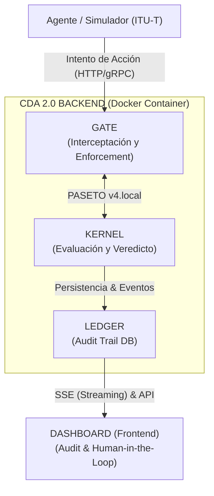

# CDA 2.0: Cognitive Decision Architecture
### Deterministic Governance & Forensic Control Plane for AI Agents

CDA 2.0 is a deterministic runtime control plane designed and developed by Matias Salgado to bridge autonomous AI agent intents with corporate business rules and international regulatory mandates. It provides real-time network interception, cryptographic decision leasing, and an immutable forensic audit trail for agentic systems.

---

## 🏛️ Standards & Governance Contributions (ITU-T FG-TIDA)
CDA 2.0 incorporates select normative frameworks and evaluation models proposed within the ITU-T Focus Group on Trust and Identity for Humans and Agentic AI (FG-TIDA):
* **Two-Axis Decision Evaluation:** Incorporates Zhao Xinghua's evaluation framework (Axis 1: Action Verdict / Axis 2: Evidence Attestation).
* **5-State Categorization:** Implements Cyril Gorlla's decision states (PERMIT, REMEDIATE, ESCALATE, BLOCK, INDETERMINATE).
* **TOCTOU Context-Freeze Pattern:** Integrates Ivan Palma's proposal for detecting state drift at the execution boundary.

---

## ⚖️ The Sovereignty Invariant
Every decision within CDA 2.0 follows a mathematical law of integrity:

$$D(I) = R(I) \cdot \Sigma$$

Where:
- **D(I):** Final Execution Decision.
- **R(I):** Policy Rule evaluation (Boolean/Deterministic).
- **Σ (Sigma Seal):** Cryptographic validation via **PASETO v4** (60s Ephemeral Lease).


## Core Architecture & System Components.

CDA aligns with the terminology and concepts of the ITU-T FG-TIDA Working Group to ensure interoperability and understanding within the AI ecosystem.



-   **CDA Enforcement Gate**: Perimeter network proxy developed by Matias Salgado. Intercepts incoming agent intents in-flight, validates PASETO v4 decision leases, enforces Ivan Palma's TOCTOU context-freeze check, and executes fail-closed blocking.
-   **CDA Policy Kernel**: Core decision engine developed by Matias Salgado. Evaluates intents against registered policies using Cyril Gorlla's 5-state model and Zhao Xinghua's Two-Axis framework, minting 60-second ephemeral PASETO v4 tokens.
-   **Forensic Audit Ledger**: Immutable persistence layer engineered by Matias Salgado. Logs full decision chains, SHA-256 policy reference hashes, and Human-in-the-Loop resolution events.
-   **Control Plane Dashboard**: Interactive real-time web console engineered by Matias Salgado. Renders Server-Sent Events (SSE) telemetry, live risk metrics, and operator escalation controls.

## 🔄 System Execution Flow
The CDA operates as a five-stage pipeline to ensure that no AI intent reaches execution without deterministic validation.

```mermaid
graph TD
    A[LLM Agent] --> B[Deterministic Policy Kernel (PEP)]
    B --> C[Attestation Envelope]
    C --> D{Runtime Enforcement Boundary}
    D --> E[Forensic Audit Ledger]
    D -- "Allow" --> F[Execution]
    D -- "Deny" --> G[Fail-Closed State]
```


## 🚦 Quick Start

### 1. Setup Environment
```bash
git clone https://github.com/matiascloudarch/cognitive-decision-architecture
cd cognitive-decision-architecture

python -m venv .venv
source .venv/bin/activate
pip install -r requirements.txt
```

### 2. Launch Unified Control Plane

```Bash
uvicorn cda.server:app --reload --port 8002
```

### 3. Dashboard: Access the live control plane at
```bash
[http://127.0.0.1:8002/](http://127.0.0.1:8002/)
```

### 4. Run Scenario Simulation
```bash
python -m cda.scripts.simulate_hallucination
```

### 5. Run Adversarial Security Suite
```bash
pytest cda/tests/test_adversarial.py -v -s
```

> [Technical Documentation]
> View the [Architecture Specifications](./architecture.md), [Regulatory Alignment](./regulatory-mapping.md), [ITU-T FG-TIDA Use Case Mapping](./ITU_T_FG_TIDA_USE_CASE.md) and [OWASP LLM Top 10 Mapping](./owasp-mapping.md) for deeper details.


## ⚖️ License
Licensed under the Apache License, Version 2.0. See LICENSE for details.

