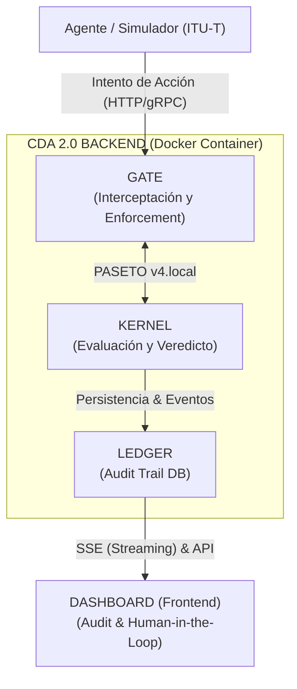

# Cognitive Decision Architecture (CDA) 2.0 - System Architecture Specification

## Executive Architecture Overview

CDA 2.0 is a deterministic execution control plane (Execution Gate) designed to intercept, evaluate, and audit autonomous AI agent actions in real time before they take effect in operational environments.

The architecture enforces a strict perimeter boundary: **Agents interact exclusively with the Gate**. The Kernel, Ledger, and Dashboard operate within the secure internal boundary.

---

## The 4 Core Components

### 1. The Gate (Interception & Enforcement Layer)
* **Function:** Perimeter network gateway acting as a reverse proxy/middleware between AI agents and protected execution environments.
* **Key Mechanisms:**
  * **Interception:** Holds incoming execution requests in-flight (*fail-closed* default).
  * **Context Extraction:** Captures payload, headers, session metadata, agent signatures, and environment state.
  * **Enforcement:** Executes the Kernel's decision. If `DENIED` or `BLOCKED`, cuts connection or returns `403 Forbidden`. If `PERMITTED`, forwards request to target resource.

### 2. The Kernel (Deterministic Policy Engine)
* **Function:** Core decision engine applying governance policies, jurisdiction rules, and risk evaluation algorithms.
* **Key Mechanisms:**
  * **State Machine:** Maintains short-term session state, retry counters, and agent context.
  * **Verdict Engine:** Evaluates policy boundaries against Zhao Xinghua's Two-Axis Model and Cyril Gorlla's 5-State Framework (`PERMIT`, `REMEDIATE`, `ESCALATE`, `BLOCK`, `INDETERMINATE`).
  * **Cryptographic Engine:** Mints and signs PASETO v4 tokens carrying SHA-256 policy reference hashes.

### 3. The Ledger (Audit Trail & Persistence DB)
* **Function:** Immutable store holding forensic event history and audit trails.
* **Key Mechanisms:**
  * **Forensic Evidence Chains:** Every decision event is bound to a unique SHA-256 hash and PASETO v4 cryptographic signature.
  * **Multi-Stage Logging:** Logs initial agent intents as well as Human-in-the-Loop (HITL) resolution overrides.
  * **Single Source of Truth:** Queried by external auditors and regulators to certify operational compliance.

### 4. The Dashboard (Audit & Control Frontend)
* **Function:** Web console providing real-time system monitoring and Human-in-the-Loop escalation control.
* **Key Mechanisms:**
  * **Real-Time Visualization:** Renders risk matrices, global telemetry, and active block rates via Server-Sent Events (SSE).
  * **Human-in-the-Loop (HITL):** Displays pending decisions awaiting review with interactive controls to Approve or Reject.
  * **Signature Verification:** Allows operators to inspect cryptographic seals and verify token authenticity.

---

## Cryptographic Token Scheme (PASETO v4)

CDA 2.0 uses Platform-Agnostic Security Tokens (PASETO v4) scoped by communication boundary:

* **PASETO v4.local (Symmetric Encryption):** Used for internal communication inside the backend container (`Gate ↔ Kernel`). Guarantees payload confidentiality and integrity in transit.
* **PASETO v4.public (Asymmetric Signatures):** Used for external verdict delivery and Ledger auditing. The Kernel signs decisions with its private key; external auditors verify authenticity using the corresponding public key (non-repudiation).