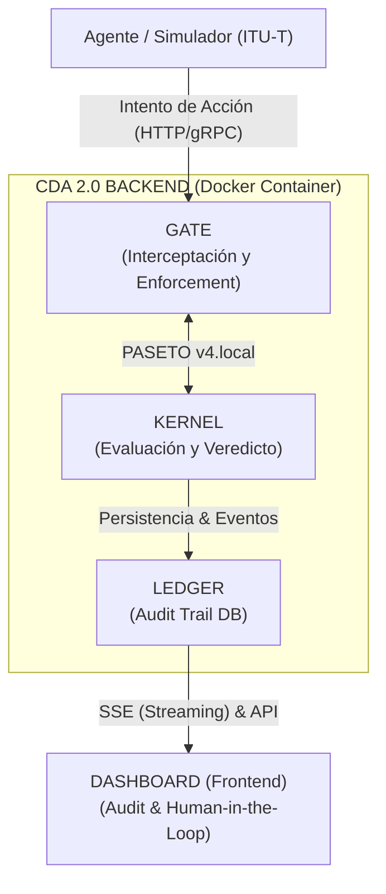

# CDA 2.0 Mapping to OWASP LLM Top 10 (Standard v1.1) 🛡️

This document provides a technical mapping of the **Cognitive Decision Architecture (CDA 2.0)** components against the **OWASP Top 10 for Large Language Model Applications & Agentic AI Systems**. 

The core objective of CDA 2.0 is to enforce the **Sovereignty Invariant**:
> **D(I) = R(I) · Σ** > *(Decision = Reasoning × Deterministic Control)*

---

## 🏗️ Architectural Overview



---

## 🛡️ Risk Mitigation Matrix

### LLM01: Prompt Injection & Intent Hijacking
* **CDA Component:** Kernel Policy Engine & Intent Normalization
* **Control Type:** Preventive (Deterministic Schema Enforcemen)
* **Implementation:** Mapping stochastic LLM output into typed AgentIntent Pydantic v2 schemas and strict regime checking.
* **Technical Control:**
```yaml
intent_normalization:
  mode: strict_regime_check
  unmapped_regime_behavior: INDETERMINATE
  fallback_action: BLOCK
  paseto_token_issued: false
```
* **Why It Works:** By treating the LLM as an untrusted environment, CDA ensures that malicious prompt injections or unmapped regulatory regimes immediately trigger an INDETERMINATE verdict with a BLOCK fallback and zero PASETO v4 token issuance, halting downstream execution.

### LLM02: Insecure Output Handling & Unsanctioned Execution
* **CDA Component:** Enforcement Gate & Two-Axis PASETO v4 Leases
* **Control Type:** Preventive (Cryptographic Non-Repudiation)
* **Implementation:** Short-lived PASETO v4 local tokens (60s TTL) encapsulating Axis 1 Action Verdicts and Axis 2 Evaluation Evidence.
* **Technical Control:**
```yaml
integrity_gate:
  signing_alg: "paseto.v4.local"
  ttl_seconds: 60
  check_policy_hash: true
  fail_state: BLOCKED
```
* **Why It Works:** Even if an LLM proposes an unauthorized or hallucinated action, the Gate will refuse to execute it unless accompanied by a valid, unexpired PASETO v4 lease minted by the Kernel with a matching policy_ref_hash.

### LLM03: Training Data Poisoning & Model Drift
* **CDA Component:** Kernel Policy Versioning & SHA-256 Binding
* **Control Type:** Detective / Preventive (Cryptographic Integrity Verification)
* **Implementation:** Real-time SHA-256 hashing (policy_ref_hash) of all active governance rules (MOCK_POLICIES).
* **Technical Control:**
```yaml
policy_verification:
  hashing_algorithm: "SHA-256"
  policy_binding: mandatory_in_paseto_payload
  tampering_behavior: BLOCK
```
* **Why It Works:** Even if a model is poisoned to produce invalid outcomes, the Kernel evaluates incoming intents against external, SHA-256 verified business policies that the model cannot alter or bypass.

### LLM04: Model Denial of Service (DoS) & Resource Exhaustion
* **CDA Component:** Kernel Boundary Limits & Rate Controls
* **Control Type:** Preventive (Boundary Limits & FinOps Enforcement)
* **Implementation:** Threshold boundaries for automated limit approvals (auto_approve_limit, max_limit) and stochastic drift indices.
* **Technical Control:**
```yaml
boundary_limits:
  auto_approve_limit: 500.00
  escalate_limit: 1000.00
  max_limit: 5000.00
  drift_index_formula: "min(1.0, max(0.0, (amount - auto) / (max - auto)))"
```
* **Why It Works:** Prevents financial or resource exhaustion attacks by enforcing automated capping (REMEDIATE), human escalations (ESCALATE), or outright blocks (BLOCK) at the Kernel level.

### LLM05: Supply Chain Vulnerabilities & Untrusted Dependencies
* **CDA Component:** Immutable Ledger Provenance Tracking
* **Control Type:** Detective (Forensic Ancestry Audit)
* **Implementation:** Immutable logging of agent ID, entity ID, principal authority, regime context, and policy hashes in the Ledger.
* **Technical Control:**
```yaml
provenance:
  log_principal_authority: true
  axis_2_evidence_logging: mandatory
  ledger_stream_format: SSE_JSON
```
* **Why It Works:** Provides a fully reconstructible audit trail. If an agent framework or LLM provider is compromised, the Ledger identifies every decision and execution trace impacted by that specific dependency.

### LLM06: Sensitive Data Disclosure & Context Leakage
* **CDA Component:** Context Decoupling & Minimal Payload Leases
* **Control Type:** Preventive (Zero-Trust Privacy Boundary)
* **Implementation:** Context isolation where business policies live entirely in the Kernel and are never exposed to the LLM reasoning context.
* **Technical Control:**
```yaml
context_isolation:
  send_policies_to_llm: false
  token_payload_minimization: true
```
* **Why It Works:** The reasoning LLM only sees operational intent parameters. The actual "Law" (governance policies and limits) resides exclusively in the Kernel, invisible to the LLM agent.

### LLM08: Excessive Agency & Unbound Execution
* **CDA Component:** Cyril Gorlla 5-State Decision Categorization & Gate Interception.
* **Control Type:** Preventive (Strict Perimeter Control)
* **Implementation:** Disallowing direct agent access to protected APIs. Agents interact strictly with the Gate.
* **Technical Control:**
```yaml
decision_states:
  PERMIT: "Execute with PASETO v4 token"
  REMEDIATE: "Cap input parameters to approved threshold"
  ESCALATE: "Require Human-in-the-Loop signature"
  BLOCK: "Deny execution at Gate boundary"
  INDETERMINATE: "Reject unmapped regime or ambiguous state"
```
* **Why It Works:** Execution authority is never delegated to the agent. Agents hold "Proposal Agency" only; "Execution Authority" resides strictly in the Gate.

### LLM09: Overreliance & TOCTOU State Drift
* **CDA Component:** Gate Context Freeze & Human Attestation
* **Control Type:** Preventive / Detective (State Drift & Accountability Guardrail)
* **Implementation:** Real-time TOCTOU drift detection (global_context_freeze) at the Gate boundary, coupled with cryptographic human signature binding (human_signature).
* **Technical Control:**
```yaml
toctou_prevention:
  check_context_freeze: true
  drift_failure_status: UNRESOLVED_DEPENDENCY_OR_STALE_CONTEXT
  final_state_on_drift: BLOCKED
```
* **Why It Works:** Intercepts Time-of-Check to Time-of-Use (TOCTOU) exploits where the underlying system state shifts between the Kernel's authorization and the Gate's execution.

---

## 📊 2026 Compliance Alignment

| Regulation / Standard | CDA Alignment Strategy | Evidence Output |
| :--- | :--- | :--- |
| **EU AI Act (Art. 11 & 14)** | High-Risk System Transparency & Human Oversight | Reconstructible PASETO v4 Ledger & HITL Signatures |
| **ITU-T FG-TIDA (UC-4 & UC-21)** | Multi-Tenant Governance & Trust Traceability | Two-Axis Tokens & 3-State Execution Traces |
| **NIST AI RMF 1.0** | Govern, Measure, Manage Functions | Deterministic Policy Kernel & Fail-Closed Gate |
| **ISO/IEC 42001** | AI Management System (AIMS) | Immutable Audit Trail & Versioned Policy Hashes |
| **FINRA / SEC** | Algorithmic Accountability | Non-repudiation via PASETO v4.public Tokens |


---
*Disclaimer: CDA is an architectural framework designed to mitigate risk, not a guarantee of total security. Always perform local penetration testing on your specific implementations.*

**Version:** 2.0.0  
**License:** APACHE 2.0  
**Author:** Matias Salgado
```
